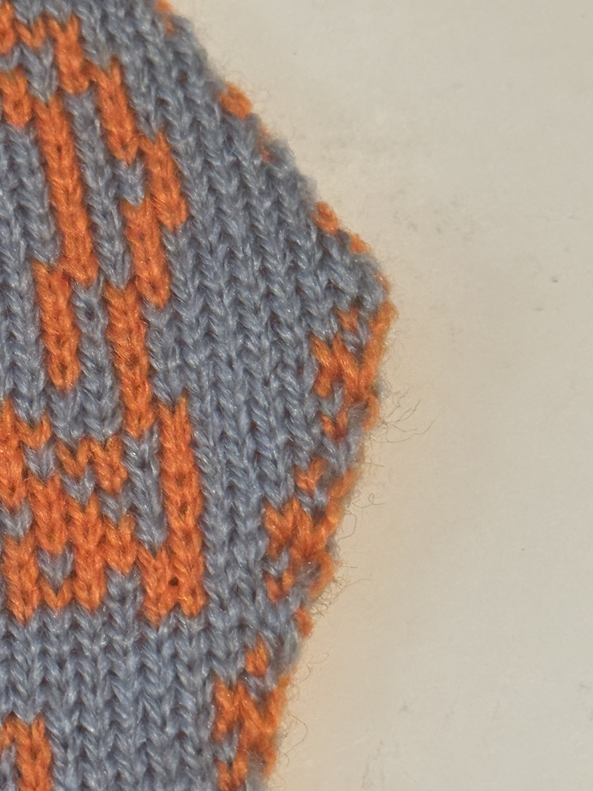
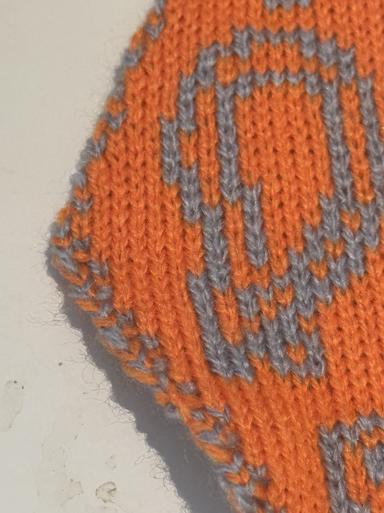

# Paisley edge detail — operator comparison photos

IMG_1201 and IMG_1202 were supplied and inspected before the 234-pass colour-preserving diagnostic was prepared, then attached again when the operator reported that the latest increase looked worse. The operator has now explicitly asked to put all this feedback on GitHub. These JPEG copies preserve the pictured fabric, normalize orientation and omit photo metadata.

**Photo identity:** both show the earlier paisley specimen. They are comparison evidence for the appearance/colour request, not photographs establishing a failing split or transfer in the later plain 234-pass diagnostic. The operator's identification of that diagnostic as the reported regression is recorded separately in [operator feedback](../../../development-trials/2026-11-14/colour-preserving-increase/operator-feedback.md).

## Requests and observations

Earlier user feedback on these photos:

> that's fine. just curious since it was working fine before. anyway, for increase, i think 1) if it looks more similar to decrease it would be better and 2) it would be better if you can use the same color on the same side. for example on the grey side, it seems to increase using orange?

The preceding paisley was reported definitely better than before but imperfect. The photos show a relatively irregular, open/elongated-looking edge section and contrasting orange/grey strands. The desired improvement was both a more compact increase and face-matching colours, while retaining linked sides.

The previous supported-split paisley candidate is 514 passes, SHA256 `2868d508005e90eab60d2ac609609870bba8f9b2fb13661f5e927a50f481aa1d`. Keep it as the better operator-reported comparison baseline; this does not certify all its increases, edge joining or repeatability.

## Grey face — IMG_1201

## Orange face — IMG_1202

These are face labels, not independent confirmation of machine-left/machine-right orientation. No machine file or settings changed with this documentation.
