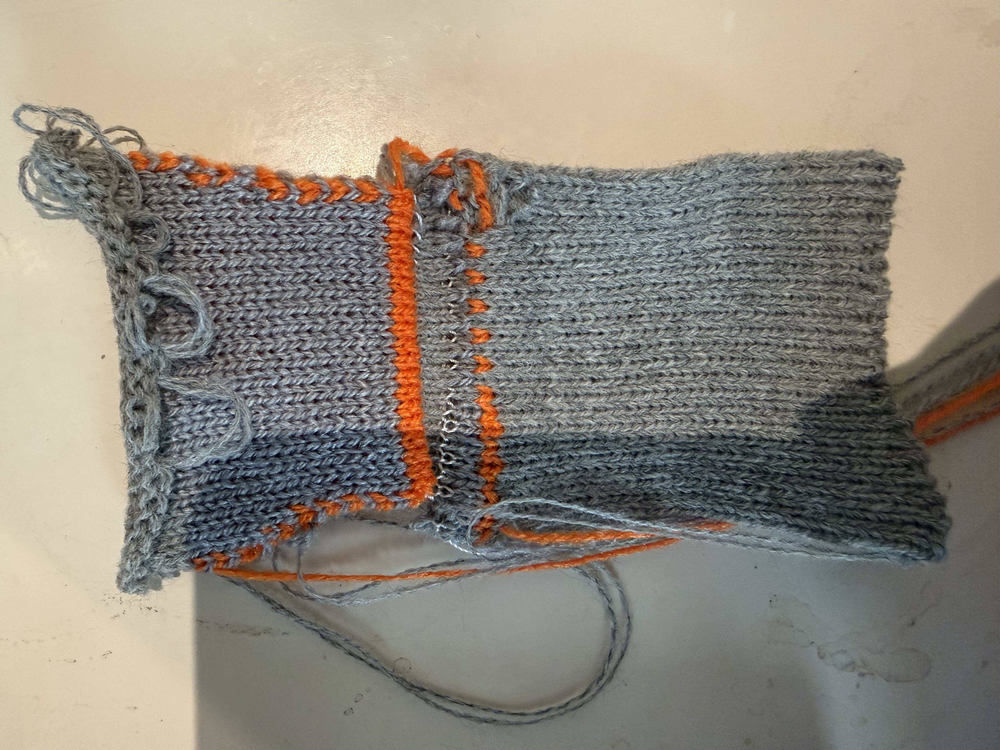

# Physical feedback: single-bed split and first reversible right-side comparison

## Operator reports

Preceding single-bed split trial (230 passes, SHA256 `fb2cb6adcfb4320992dcec26e8b80e0cbdcb905b4d25548780f20b04b5c24de5`): operator supplied IMG_1195/1196/1197 and said “this looks better. the right side is better than left”. Asked whether it finished without stops, manual stitch repairs or setting changes, the operator replied “yes it worked well. sd is mounted”. Record this as operator-reported success of the preceding single-bed trial; not a measured per-event or per-method ranking. Those three photos were inspected locally and are not included in this report.

The operator then authorized proceeding to the right-side reversible comparison. Its unchanged reviewed file was copied to SD as command.kc, hash verified, and card safely ejected. This followed the preceding-knit condition and the parent package's 13 November implementation review. Earlier per-file hold text records preparation-time status.

For the reversible specimen, supplied IMG_1198 and reported verbatim:

> here. the right side is better, but im not sure that's what you are calling right?

Then requested posting this feedback and recommendations to GitHub. Do not apply the preceding single-bed “worked well” response as a stop-free confirmation for this later reversible run.

## Exact reversible candidate and orientation

226 passes, 272879 bytes, SHA256 `44d663f1121e272ca086c14e78d889cff561193ec1df36629a4c4e185c78dd20`. Source: `docs/development-trials/2026-11-13/reversible-split/right/program.kc`. SD receipt preserved here. 18 body cycles, 20 → 22 → 24 columns; two increase events, no decreases. Each event tests a different old-front colour phase; this is not two repeat specimens.

Programmed machine-right edge: new outward-first supported split sequence. Machine-left edge: old borrowed-loop control with two empty rear starts. This is new versus old reversible increase, NOT Simple versus Fashioned from the preceding single-bed trial. Split passes 141/146 and 163/168.

Requested setup was C4 grey front ground and C3 orange rear ground, previous single 2/14 acrylic pair; C1 draw, C6 waste; main stitch7, speed200, roller450. Actual cone/settings changes were not separately reconfirmed for this run.

Photo shows grey face toward the camera, long initial waste below, narrow top waste above. With the specified grey front face and an unmirrored image, photo-right corresponds to programmed machine-right/new split; photo-left to old control. This is an orientation inference from the file and photo, not an operator-applied physical edge label. Mark the candidate edge before turning the specimen over: a sideways flip places it on the viewer's left on the orange face.

## What the photo supports

The photographed right border looks more compact and regular; the left widening area has more open/elongated-looking loops. This agrees with the operator's visual preference and is encouraging first physical evidence for the new construction. The body and top waste are present. Loose grey yarn across the upper face is not by itself evidence of a dropped stitch.

Only the grey face is shown. The photo does not confirm reverse-face capture, both side joins, every terminal split, stop-free operation, startup behavior or repeatability. No event-specific ranking, dimensions, or formal Knit-proven promotion. Both edges share take-down and extra carriage moves; the control is not a replay of the prior paisley file. Supported loop ancestry is a plausible explanation for the improved edge, not an isolated causal proof from one specimen.

## Recommended next steps

1. Mark the new-increase edge and inspect/photograph the orange reverse face and both joined edges. Record any misses, machine stops, interventions, or setting changes for this reversible run; distinguish startup faults (including C6 passes80–86 and outer draw-loop release107) from split events.
2. Repeat this exact right-side file once with unchanged yarn/settings to test repeatability, if the reverse face and joins are sound.
3. Run the prepared mirrored left-side file (222 passes, SHA256 `9f778ff0817456639f004c2a6b6d786c998a6350233e7dfba82e6256788ff51d`), new construction on machine-left and old on machine-right. Knit it twice as planned. This tests whether the benefit follows the construction rather than simply the machine side. Do not conclude the left-side implementation works from this right-side specimen.
4. If both orientations capture and join reliably, implement/verify a SMALL reversible paisley increase-and-decrease trial using the new increase and existing paired cross-bed decrease. Check narrow start, actual colour choreography, joins and carrier clearance. Preserve the old decrease initially so the increase remains the changed variable. This combined file has not yet been prepared or qualified.
5. Refine tasteful trim separately (#19); it need not block the combined increase/decrease trial. The contrasting edge joins remain visible even if the increase improves.

No machine file or production compiler was changed with this feedback. No new SD copy made with this report.

